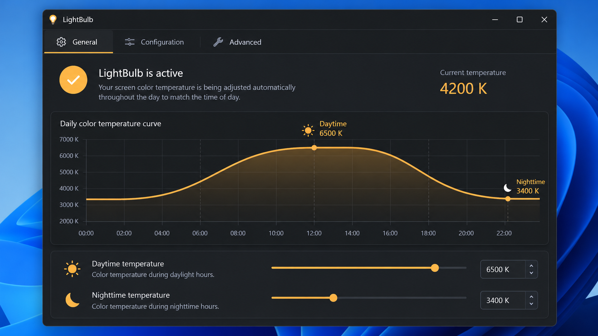
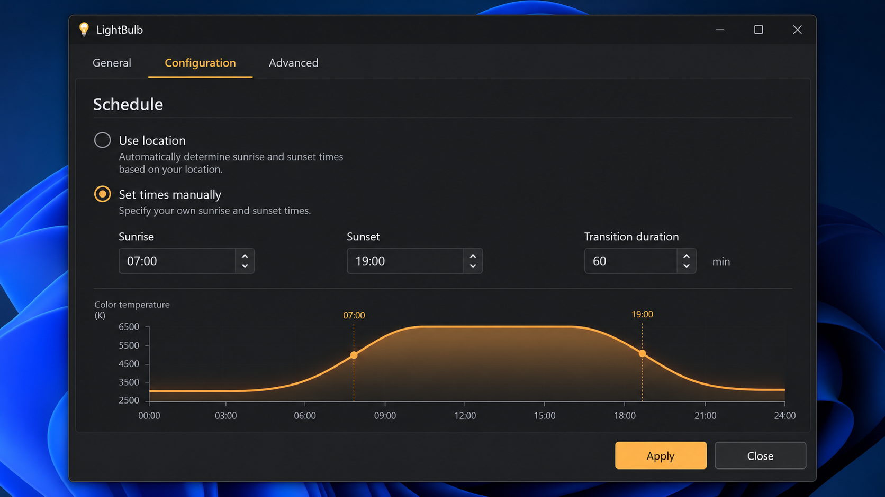
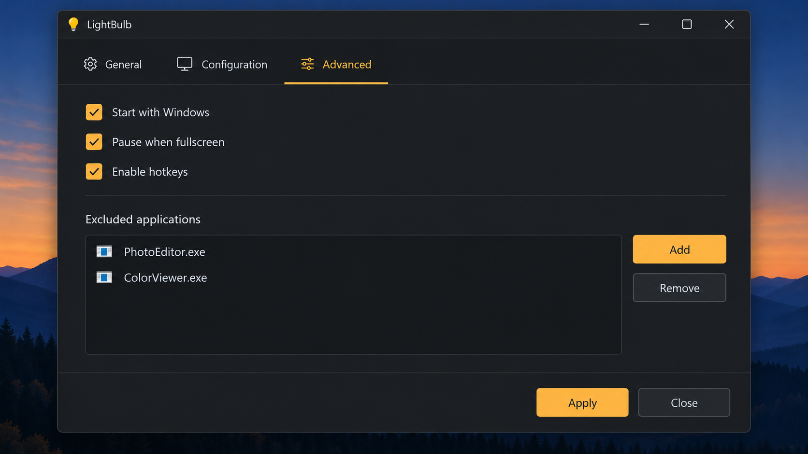

# Light Bulb Types - A Practical Light Bulb Buying Guide

Lightbulb is an informational lighting reference maintained by **Light Bulb Buying Guide** in the **Light Bulb Types** repository. It explains different types of light bulbs, bulb bases, brightness, wattage, color temperature, energy efficiency, lifespan, and lightbulb invention history.

## Features

- Compare an incandescent light bulb, halogen light bulb, compact fluorescent light bulb, fluorescent light bulb, and LED light bulb.
- Match light bulb base types such as an E26 bulb, E27 bulb, and E12 bulb.
- Understand an A19 bulb shape separately from light bulb fitting types.
- Convert light bulb wattage expectations into lumens.
- Select warm white, soft white, cool white, or daylight light bulbs.
- Compare light bulb lifespan and energy consumption.
- Explore programmable LED effects and practical lighting examples.

The **Light Bulb Buying Guide** organization uses the **Light Bulb Types** repository to separate four details that shoppers often confuse:

| Property | Meaning | Common Examples |
|---|---|---|
| Technology | How light is produced | LED, incandescent, halogen, CFL, fluorescent |
| Shape | The physical envelope | A19 bulb |
| Base | The electrical and mechanical connector | E26 bulb, E27 bulb, E12 bulb |
| Output | The visible brightness | Lumens |

### Guide Vocabulary

Lightbulb, light bulb, light bulbs, light bulb types, LED light bulb, light bulb buying guide, lighting, led, incandescent, color-temperature, lumens, energy-efficiency, bulb-base

### What are the five different types of light bulbs?

The five commonly compared light bulb types are incandescent, halogen, compact fluorescent, linear fluorescent, and LED.

1. **Incandescent light bulb:** An electric current heats a tungsten filament until it glows. Incandescent bulbs usually provide warm light and accurate color rendering, but much of their electricity becomes heat rather than visible light. Their relatively short life and low efficiency make them a poor choice when energy saving light bulbs are required.
2. **Halogen light bulb:** A halogen bulb is an improved incandescent lamp containing halogen gas. It can be smaller, brighter, and somewhat more efficient than a traditional incandescent light bulb, but it still operates at a high temperature.
3. **Compact fluorescent light bulb:** CFL bulbs pass electricity through gas and use a phosphor coating to create visible light. A compact fluorescent light bulb uses less energy and lasts longer than an incandescent bulb, although it can require warm-up time and contains a small amount of mercury.
4. **Fluorescent light bulb:** A linear fluorescent light bulb uses the same discharge-and-phosphor principle as CFL bulbs but normally comes in a tube. It requires compatible control gear and should be recycled appropriately.
5. **LED light bulb:** LED light bulbs produce light through electroluminescence in semiconductor devices. They generally offer the strongest light bulb energy efficiency comparison, long service life, instant output, and many light bulb color options.

CFL bulbs and linear fluorescent lamps use related technology, but the **Light Bulb Types** repository treats them as separate buying categories because their shapes, fittings, fixtures, and typical applications differ. For most homes, LED light bulbs are now the usual choice among energy efficient light bulbs.

## Download, Install and Example

The **Light Bulb Buying Guide** material is paired with programmable lighting examples in the **Light Bulb Types** repository. These examples demonstrate brightness, color, transitions, segments, current limits, external triggers, web controls, and audio-reactive lighting with addressable LEDs.

Useful starting points include:

- [Automatic mode cycling](examples/auto_mode_cycle/auto_mode_cycle.ino)
- [Serial control](examples/serial_control/serial_control.ino)
- [External trigger control](examples/external_trigger/external_trigger.ino)
- [Current limiting](examples/ws2812fx_limit_current/ws2812fx_limit_current.ino)
- [Color transitions](examples/ws2812fx_transitions/ws2812fx_transitions.ino)
- [Matrix lighting](examples/ws2812fx_matrix/ws2812fx_matrix.ino)
- [Web interface](examples/esp8266_webinterface/esp8266_webinterface.ino)
- [Custom effects](examples/ws2812fx_custom_effect/ws2812fx_custom_effect.ino)

The library interface is documented in the [WS2812FX API](extras/WS2812FX%20API.md) and [WS2812FX Users Guide](extras/WS2812FX%20Users%20Guide.md). Build metadata is available in [CMakeLists.txt](CMakeLists.txt), [platformio.ini](platformio.ini), [library.json](library.json), and [library.properties](library.properties).

### Light Bulb Brightness Guide

Lumens measure visible output, while watts measure electrical power. A traditional 60 watt light bulb commonly produces about 800 lumens. An LED light bulb can provide similar brightness while using substantially lower wattage, so LED light bulb wattage should not be compared directly with incandescent wattage.

| Traditional Incandescent Reference | Typical Brightness | Typical LED Light Bulb Wattage |
|---:|---:|---:|
| 40 W | About 450 lumens | About 4–6 W |
| 60 W | About 800 lumens | About 7–10 W |
| 75 W | About 1,100 lumens | About 9–13 W |
| 100 W | About 1,600 lumens | About 13–18 W |

Actual output and power vary by product. The fixture’s maximum wattage remains an electrical and thermal limit, while lumens remain the better measure for choosing brightness.

### Light Bulb Color Temperature Guide

The light bulb Kelvin scale describes the appearance of white light. A lower Kelvin value looks warmer and more amber, while a higher value looks cooler and bluer.

| Approximate Range | Description | Typical Use |
|---:|---|---|
| 2200–2700 K | Warm white light bulb or soft white light bulbs | Bedrooms, living rooms, decorative lighting |
| 3000–3500 K | Neutral warm white | Kitchens, dining rooms, general household lighting |
| 4000–4500 K | Cool white light bulbs | Work areas, utility rooms, offices |
| 5000–6500 K | Daylight light bulbs | Task lighting, workshops, detail-oriented spaces |

Color temperature does not indicate brightness. Two light bulbs can have the same lumens but different Kelvin values. Programmable color behavior can be explored through [color functions](wled00/colors.cpp), [palettes](wled00/palettes.cpp), and [lighting modes](src/modes.cpp).

### What is the base of a lightbulb called?

The base of a lightbulb is usually called the **bulb base** or **lamp cap**. It holds the light bulb in the socket, provides electrical contacts, and often helps position or retain the lamp mechanically.

An E26 bulb has a 26 mm Edison screw base and is the common standard light bulb base in North America. An E27 bulb has a closely related 27 mm Edison screw base commonly used in regions with different mains standards. An E12 bulb uses a smaller 12 mm candelabra screw base.

The letter identifies the fitting family, while the number normally identifies a relevant dimension in millimeters. Other light bulb fitting types can use bayonet, bi-pin, twist-lock, or specialized connectors. The bulb shape is separate: An A19 bulb describes the envelope, not its base.

To determine how to identify a light bulb base:

1. Disconnect power and allow the bulb to cool.
2. Check the existing bulb for a printed base code.
3. Determine whether the fitting is screw, bayonet, pin, or twist-lock.
4. Measure the screw diameter or pin spacing when no marking is readable.
5. Confirm the fixture voltage, maximum wattage, and dimmer compatibility.
6. Match both the light bulb base type and bulb dimensions before replacement.

## Effects

The programmable examples preserve the source project’s emphasis on controllable lighting effects. The [core WS2812FX implementation](src/WS2812FX.cpp), [effect modes](src/modes_funcs.cpp), [WLED effects](wled00/FX.cpp), and [2D effects](wled00/FX_2Dfcn.cpp) demonstrate how LED brightness and light bulb color concepts translate into dynamic lighting.

Representative effects include:

- Static illumination
- Blink and fade
- Breath and pulse
- Color wipe
- Rainbow cycle
- Theater chase
- Running lights
- Twinkle and sparkle
- Strobe
- Comet
- Fireworks
- Fire flicker
- Custom effects

Examples for more advanced behavior include [segment sequencing](examples/ws2812fx_segment_sequence/ws2812fx_segment_sequence.ino), [virtual strips](examples/ws2812fx_virtual_strip/ws2812fx_virtual_strip.ino), [audio-reactive effects](examples/ws2812fx_audio_reactive/ws2812fx_audio_reactive.ino), and [custom FastLED effects](examples/ws2812fx_custom_FastLED/ws2812fx_custom_FastLED.ino).

### What type of light is a lightbulb?

A lightbulb is a source of artificial electric light. It converts electrical energy into visible electromagnetic radiation, but the conversion process depends on the light bulb type.

An incandescent light bulb and halogen light bulb produce thermal radiation by heating a filament. A fluorescent light bulb and compact fluorescent light bulb create an electrical discharge that excites a phosphor coating. An LED light bulb produces electroluminescence when current passes through semiconductor junctions.

A lightbulb can also be described by its spectral appearance. Warm white light bulbs emphasize warmer yellow and red tones, while daylight light bulbs contain a cooler-looking balance with more blue. The Kelvin value describes that appearance; lumens describe brightness; watts describe power consumption.

### Light Bulb Lifespan Comparison

| Light Bulb Type | Approximate Typical Life | Relative Efficiency |
|---|---:|---|
| Incandescent light bulb | About 1,000 hours | Low |
| Halogen light bulb | About 2,000–4,000 hours | Low to moderate |
| CFL bulbs | About 6,000–15,000 hours | Moderate |
| Fluorescent light bulb | About 10,000–30,000 hours | Moderate to high |
| LED light bulbs | About 15,000–50,000 hours | High |

Heat, enclosed fixtures, switching frequency, driver quality, voltage variation, and dimmer compatibility can shorten actual service life. Good thermal management is particularly important for an LED light bulb because excessive heat degrades LEDs and electronic drivers.

### What are the main parts of a light bulb?

The main parts of a light bulb depend on its technology, but most include an envelope, a light-producing element, electrical connections, internal support or control components, and a base.

- **Envelope or bulb:** The glass or plastic outer body protects the internal components and shapes or diffuses the emitted light.
- **Light-producing element:** This is a tungsten filament in an incandescent light bulb, an arc tube and phosphor in a fluorescent light bulb, or semiconductor LED packages in LED light bulbs.
- **Base or cap:** The bulb base mechanically connects the lamp to its socket and carries electrical power through insulated contacts.
- **Electrical conductors:** Lead-in wires, contact pads, or circuit traces transfer current from the base to the light-producing element.
- **Driver or ballast:** LED light bulbs contain electronic driver circuitry, while CFL bulbs and fluorescent lamps require ballast circuitry to regulate current.
- **Thermal components:** An LED light bulb commonly includes a heat sink or thermally conductive body to move heat away from the LEDs and driver.
- **Optical components:** Diffusers, reflectors, lenses, phosphors, and coatings control light bulb brightness, beam shape, color, and glare.
- **Internal atmosphere and support:** Incandescent and halogen lamps use inert or halogen gases, while discharge lamps use controlled gas and vapor mixtures. Supports hold filaments, tubes, or circuit assemblies in place.

## Projects Using Light Bulb Types

The **Light Bulb Buying Guide** organization maintains **Light Bulb Types** as both a buying reference and a technical lighting companion. Its source tree includes reusable custom effects such as [Heartbeat](src/custom/Heartbeat.h), [Rain](src/custom/Rain.h), [TwinkleFox](src/custom/TwinkleFox.h), [VUMeter](src/custom/VUMeter.h), and [Rainbow Fireworks](src/custom/RainbowFireworks.h).

The historical side of the light bulb buying guide distinguishes the first light bulb experiments from the commercially practical Thomas Edison light bulb. No single inventor created every part of the modern lightbulb. Earlier researchers demonstrated electric arcs and incandescent conductors, while Edison and his team developed a durable incandescent system together with practical generation, wiring, sockets, and distribution. The lightbulb invention was therefore a sequence of improvements rather than one isolated event.

Contributions to **Light Bulb Types** should follow [CONTRIBUTING.md](CONTRIBUTING.md) and [CODE_OF_CONDUCT.md](CODE_OF_CONDUCT.md). Security concerns are covered by [SECURITY.md](SECURITY.md).

## License

[LICENSE](LICENSE)
